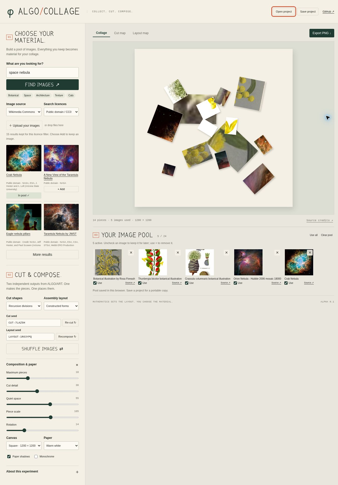

# ALGO/COLLAGE

**Collect. Cut. Compose.**

A browser collage studio built on [ALGO/ART](https://github.com/southernadd-cmyk/algoart). Build an image pool from free image searches or your own uploads. One seeded ALGO/ART output defines the cut shapes; a second output places the fragments into a new composition.

**[Open the live studio →](https://southernadd-cmyk.github.io/algoCollage/)**



*How far can the golden ratio govern a collage while its fragments remain unexpected?*

## First prototype

- Search **Wikimedia Commons** or **Openverse**, or choose a subject shortcut.
- Add individual results to an image pool; combine multiple searches and uploads.
- Keep up to **24 images**. Uncheck an image to exclude it without removing it.
- Choose **Constructed Forms**, **Recursive Divisions** or **Orbital Studies** independently for cutting and assembly.
- **Re-cut** changes the cut seed. **Recompose** changes the layout seed while retaining the selected source fragments. **Shuffle images** changes their assignment.
- Adjust piece count, cut detail, quiet space, scale, rotation, paper, shadows and monochrome treatment.
- Inspect the cut map and layout map.
- Export a **2× PNG** with embedded UTF-8 source credits, or download readable credits separately.
- Save/open a **portable JSON project** containing the images, seeds and settings. The pool is also stored in this browser using IndexedDB.

This is geometric collage: it cuts image regions, including their backgrounds. Subject extraction and AI segmentation are outside this first version. Different layout families generate different numbers of positions; **Maximum pieces** caps that number.

## Run

No framework, build step, runtime dependencies, API keys or backend:

```sh
git clone https://github.com/southernadd-cmyk/algoCollage.git
cd algoCollage
python3 -m http.server 8000
```

Open **http://localhost:8000/**. On Windows, use `py -m http.server 8000` if appropriate. Serve over HTTP rather than opening `index.html` as a local file.

For GitHub Pages, select **Settings → Pages → Source → GitHub Actions**. The Pages workflow tests the application and publishes its static assets whenever `main` changes; it can also be run manually. All asset paths are relative, so the repository subpath works.

## Images and licences

The default filter keeps sources identified as **public domain or CC0**. An optional filter also accepts **CC BY / CC BY-SA**, retains source and licence links, and includes them in the credits. Unknown, noncommercial and no-derivatives licence labels are excluded. These are metadata filters, not independent verification of the original rights.

The APIs are separate from the image hosts. A search result can appear even when its host blocks browser downloads. Only images fetched successfully as raster blobs enter the pool, keeping PNG export safe from cross-origin canvas restrictions. Failed hosts can be bypassed by choosing another result or uploading a saved image. API rate limits and downtime are handled without losing the pool. Commons search and downloads were verified on the live site; Openverse could not be reached from the validation browser, so its live integration remains unverified.

Images are reduced to at most **1600 px** on their longest side before storage; individual inputs are limited to **16 MB**, and portable projects to **64 MB**. Export dimensions are 2000 × 2800 portrait, 2800 × 2000 landscape or 2400 × 2400 square. A larger export does not recover image detail lost through source resizing. Save a project before clearing browser data.

API references: [MediaWiki search](https://www.mediawiki.org/wiki/API:Search), [image information](https://www.mediawiki.org/wiki/API:Imageinfo), [cross-site requests](https://www.mediawiki.org/wiki/API:Cross-site_requests), [Commons reuse](https://commons.wikimedia.org/wiki/Commons:Reusing_content_outside_Wikimedia), [Openverse API](https://api.openverse.org/v1/).

## How it works

1. `js/sources.js` searches providers and normalises source metadata.
2. `js/composition.js` runs the original ALGO/ART engine. Closed engine paths and recursive territories become cut masks; layout metadata becomes placement slots.
3. Each mask cuts the same proportional region from a source image fitted to the cut plane. A separate image seed cycles through active sources and their fragments.
4. `js/render.js` composes those fragments on paper, preserving their aspect ratios and applying the assembly positions, rotations and hierarchy.
5. `js/storage.js` persists the pool and validates portable projects before replacing existing work. `js/png.js` embeds source credits in exported PNGs.

The engine adapter preserves the original random-number calls and restores its temporary state. The five engine files in `vendor/algoart/` are **unchanged**, pinned to renderer **V7**, commit [`d231259`](https://github.com/southernadd-cmyk/algoart/commit/d231259ad08a690c1109a6af7f624c769c50eadc). `upstream.json` records their blob hashes. The marker font is reused from that same author's project. ALGO/ART itself is not modified.

## Checks

With Node.js 22 or later:

```sh
npm test
```

Tests exercise all three engine families, both orientations and square output; determinism; separate seed effects; excluded images; licence filters; project validation; upstream file integrity; and PNG credit chunks. GitHub Actions runs these checks and JavaScript syntax checks.

Browser validation and the limitation of live-provider access are recorded in [DEVELOPMENT.md](DEVELOPMENT.md).

## Next experiments

Expand to trajectory and growth layouts; offer torn-paper masks; allow per-image weighting and crop positioning; then consider a small image proxy only if real host compatibility warrants it. Keep the independent image pool, cut seed and layout seed as the core interaction.
